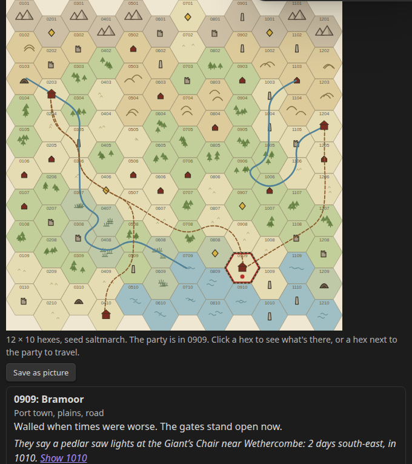
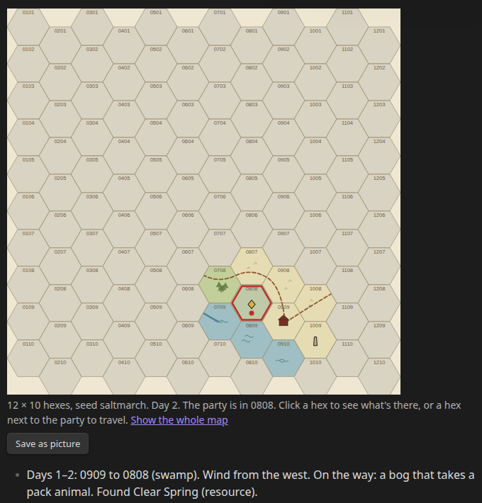

# Hexwright

Hex-crawl maps for tabletop games, drawn from a seed right in your Obsidian notes: terrain, rivers, roads and towns on a numbered hex grid, with something in every hex and a party that travels across it one day at a time.



**Try it in your browser first:** [bulkhead.bananafest-destiny.com/hex-crawl-generator](https://bulkhead.bananafest-destiny.com/hex-crawl-generator/) runs the real plugin code, fog and travel included.

Put a `hexwright` block in a note and you get a region of plains, forest, hills, mountains, swamp and sea, with rivers running down to the coast, roads between the towns, and every hex numbered the old way (0101 is the top-left). The same seed always draws the same region, so a map in your campaign notes never changes under you.

Every hex is keyed. Click one to see what's there: a town or a village with a name, a ruined tower or barrow, a lair, a landmark, a resource worth money, or just the country itself with a line about it. Many hexes carry a rumour that points at another hex by number and days of travel, so the map hands your players their next lead. **Open its note** writes a note for that hex beside your map note, ready for your own writing.

Hexwright is free.

## Install

From Obsidian: Settings → Community plugins → Browse → search "Hexwright", then Install and Enable.

By hand: copy `main.js`, `manifest.json` and `styles.css` from the latest release into `<your vault>/.obsidian/plugins/hexwright/`, then enable it under Community plugins.

## Use

Open the command palette and run **Insert a hex crawl**. It puts a `hexwright` block with a new seed where your cursor is, and the map is drawn under it in reading view and live preview. Or type a block yourself:

````
```hexwright
seed: saltmarch
size: medium
terrain: mixed
fog: off
```
````

| Key | What it does |
| --- | --- |
| `seed` | Any word or number. The same seed draws the same map. |
| `size` | `small` (8 × 6), `medium` (12 × 10), `large` (20 × 16), or your own, like `16x12` (4 to 40 each way). |
| `terrain` | The lean of the country: `mixed`, `forest`, `steppe`, `mountains`, `swamp` or `coast`. |
| `start` | The party's first hex, like `0607`. Leave it out and the party starts in the town nearest the middle. |
| `fog` | `on` hides every hex the party hasn't seen. `off` (the default) shows the whole map. |
| `encounters` | A note with your own encounter list, like `[[Wild encounters]]` (see below). |

Lines starting with `#` are ignored, so you can leave yourself notes in the block.

On a phone or in a narrow pane, a big map keeps its hexes big enough to tap and scrolls sideways instead, starting with the party in the middle.

## Travel



Click a hex next to the party and its card offers **Travel here**. Each move is one hex:

- Plains, forest and hills take a day; swamp and mountains take two, unless a road runs through both hexes.
- Off the road and away from the river, woods and swamp can get the party lost (2 in 6), hills and mountains less often (1 in 6). Lost, it comes out in a different hex next to where it started.
- Every move rolls the weather and a chance of meeting something, more often in forest, swamp and mountains.

The day is written into your note as a list line under the map, like `- Days 1–2: 0909 to 0808 (swamp). Wind from the west. On the way: a bog that takes a pack animal. Found Clear Spring (resource).` The party's hex, the day count and the hexes it has been in are kept in the block as `at:`, `day:` and `visited:` lines, so the note is the save. Edit or delete those lines to move the party or start over.

With `fog: on`, the party sees the hexes around every hex it has been in, and two hexes out from hills and mountains. **Show the whole map** under the map lifts the fog for you only; it isn't saved.

The rolls come from the seed and the day, so the same move from the same place on the same day rolls the same.

### Your own encounters

Add `encounters: [[Wild encounters]]` to the block and the party meets things from that note instead of Hexwright's list. Every list item in the note is one encounter. Items under a heading that names a terrain (`## Forest`, `## Swamp`, `## Hills`, `## Mountains`, `## Plains`; woods, marsh and the like work too) come up only there; every other item comes up anywhere that has no list of its own.

```markdown
# Wild encounters
- a pedlar who sells maps that are nearly right
- the baron's tax collectors
## Forest
- a green knight at a ford
```

How often something turns up stays the same. If the note can't be found, the map says so and travel uses Hexwright's own list.

## Hex notes and Mapsmith

**Open its note** writes `<seed> <hex>.md` next to the note that holds the map, with the hex's name, what's there and its rumour, and a Notes heading for you. Towns, villages and ruins also get a `mapsmith` block with a seed of their own, so with the free [Mapsmith](https://github.com/walkertbrown/mapsmith) plugin installed, the town's streets or the ruin's dungeon are drawn right there. Without Mapsmith the block just shows as text. [Mapsmith Pro](https://bulkhead.bananafest-destiny.com/go/pro/hexwright), $6 once, saves that town or dungeon for Foundry, Atlas VTT or Roll20 with its walls and doors (walls in Roll20 need a paid Roll20 plan).

## Save as picture

**Save as picture** writes the map as it's shown (with the fog, if it's on) as a PNG next to your note. Hexes are flat-topped, 100 pixels from flat side to flat side, and the grid starts at the top-left corner of the picture, so a virtual tabletop's hex grid can be laid over it.

- **Foundry VTT:** pick one of the **Hexagonal Columns** grid types (Foundry's flat-topped ones) and line it up with the Grid Alignment Tool, the angled ruler next to Grid Type.
- **Owlbear Rodeo:** pick **Hex Horizontal** (Owlbear's flat-topped grid, point to the right) and set the columns to the map's width in hexes, which the save notice tells you.

## Privacy

Hexwright works offline. It reads and writes only the note the map is in and the hex notes and pictures you ask it for. It sends nothing anywhere.

## License

MIT
